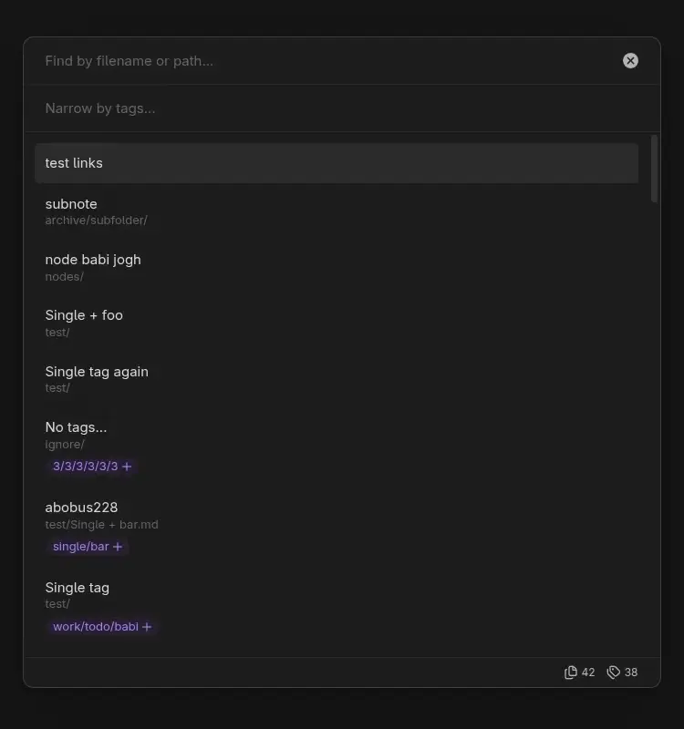

# Tag Scope for Obsidian

Language: [EN](./README.md), [RU](./README.ru.md)

> You do not need to remember the exact path to your notes or build a complex storage structure in advance. Add key tags at any nesting level to your notes, and **Tag Scope** will suggest relevant filters to help you find what you need, even in a large knowledge base. Get the most out of your tag system.

**Tag Scope** gradually narrows the set of notes using tags, then refines the search by note name, path, aliases, and a frontmatter title property (such as `title`).

Search supports fuzzy matching. The interface has a minimal, native Obsidian look, adapts to mobile devices, and supports keyboard use for the main actions.

**Link insertion mode (Insert link)** is an alternative to Obsidian's standard suggestions when entering a note link: find a note with **Tag Scope** and insert the link directly into the editor.

## Features in detail

- **Tag filtering.** Narrow the results with multiple tags. A parent tag also matches notes with nested tags.
- **Include and exclude filters.** Add a tag to the result set or exclude notes that have it.
- **Relevant tag suggestions.** Suggestions update based on the current results and show how many notes have each tag and its nested tags.
- **Fuzzy search.** Search tags, note names and paths, aliases, and frontmatter titles.
- **Exclude tags from search.** Hide tags and nested tags while keeping the notes that contain them in the results.
- **Exclude notes by tag.** Remove notes with specified tags or their nested tags from the results.
- **Obsidian settings.** Files and folders excluded in Obsidian's settings are omitted from search.
- **Result counters.** See the number of matching notes and available tags.
- **File actions.** Open notes using the default or alternate behavior, or reveal them in Obsidian's File Explorer.
- **Link insertion.** Search for a note from the editor and insert a link to it in the current file. Selected text can be used as the link alias.

To start a search, run **Open search** from the command palette or select **Open search by tags** from the ribbon. To insert a link, place the cursor in the editor and run **Insert link**.

## Example workflow

Suppose you are looking for a note containing the minutes of a work meeting. Notes on this topic use the `work` and `meeting` tags.

1. Run **Open search**, enter `work` in the tag field, and select the suggestion. The results will include notes with this tag and its nested tags.
2. Suggestions update to reflect the remaining notes. Enter `meeting` and select the suggestion to keep notes that have both tags.
3. To exclude canceled meetings, for example, enter `!status/canceled` in the tag field and select the suggestion. Notes with this tag will be removed from the current result set.
4. Enter part of a note name, path, alias, or title property value in the note search field to refine the results.
5. Select a result with the arrow keys and press `Enter` to open the note using the default behavior.

## Keyboard shortcuts and interactions

| Key or action | Result |
| --- | --- |
| `Tab` | Switch between the tag and note search fields. |
| `↑/↓` | Move through the search results. |
| `Enter/Click` a result | In search mode, open the note using the default behavior; in link insertion mode, insert a link to it in the current file. |
| `Ctrl/Cmd + Enter/Click` a result | In search mode, use the alternate opening behavior; in link insertion mode, insert a link to it in the current file. |
| `Alt + Enter/Click` a result | Reveal the note in Obsidian's File Explorer, if it is open. |
| `Click` a tag on a result | Add the tag as an include filter. |
| `Ctrl/Cmd + Click` a tag on a result | Add the tag as an exclude filter. |
| `Enter/Click` a tag suggestion | Add the selected tag as an include filter. |
| `Ctrl/Cmd + Enter/Click` a tag suggestion | Add the selected tag as an exclude filter. |
| Start a tag query with `!` | Add the selected suggestion as an exclude filter. |
| `Click` a selected tag | Remove it from the search. |
| `Ctrl/Cmd + Click` a selected tag | Toggle it between included and excluded. |
| Press `Backspace` twice while the tag field is empty | Remove the last selected tag. |
| Click the mode indicator at the bottom of the window | Return to normal search mode. |

> Selected tags, search results, and their tags have context menus.

## Settings

- **Tag suggestion sort order.** Choose how equally relevant tag suggestions are sorted: by name or by usage count in the current result set.
- **Default note opening behavior.** Choose whether to open notes in the current tab or a new tab. The alternate action uses the other behavior.
- **Note title property.** Enter a frontmatter property name, such as title, to use its string value as the note title. Leave it empty to use the filename.
- **Exclude tags from search.** These tags and their nested tags are excluded from search and suggestions, but notes containing them remain visible.
- **Exclude notes from search by tag.** Notes with these tags or their nested tags are excluded from search results.
