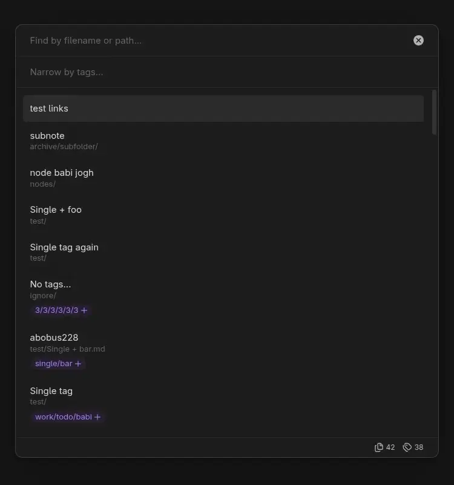

# Tag Scope для Obsidian

Язык: [EN](./README.md), [RU](./README.ru.md)

> Не нужно помнить точный путь к заметке или заранее выстраивать сложную систему хранения. Добавляйте к заметкам ключевые теги любой вложенности, а **Tag Scope** предложит релевантные фильтры и поможет найти нужную информацию даже в большой базе знаний. Используйте систему тегов на 100%.

**Tag Scope** помогает постепенно сужать выборку заметок по тегам, а затем уточнять поиск по названию, пути, псевдонимам (`aliases`) и свойству заголовка из frontmatter (например, `title`).

Поиск поддерживает нечеткие совпадения (fuzzy search). Интерфейс выполнен в минималистичном нативном стиле Obsidian, адаптирован для мобильных устройств, а основные действия можно выполнить с клавиатуры.

**Режим вставки ссылки в текущий файл (Insert link)** - альтернатива стандартным подсказкам Obsidian при вводе ссылки на заметку: найдите заметку с помощью **Tag Scope** и вставьте ссылку прямо в редактор.

## Подробнее о возможностях

- **Фильтрация по тегам.** Сужайте выборку несколькими тегами. Родительский тег также находит заметки с вложенными тегами.
- **Включающие и исключающие фильтры.** Добавляйте тег к выборке или исключайте заметки с ним.
- **Релевантные подсказки тегов.** Подсказки обновляются по текущим результатам и показывают число заметок с тегом и его вложенными тегами.
- **Нечеткий поиск.** Ищите по тегам, названиям и путям заметок, псевдонимам и заголовкам из frontmatter.
- **Исключение тегов из поиска.** Скрывайте теги и вложенные теги, оставляя содержащие их заметки в результатах.
- **Исключение заметок по тегу.** Полностью убирайте из результатов заметки с указанными тегами или их вложенными тегами.
- **Учет настроек Obsidian.** Файлы и папки, исключенные в настройках хранилища, не попадают в поиск.
- **Счетчики результатов.** Смотрите число найденных заметок и доступных тегов.
- **Действия с файлами.** Открывайте заметки обычным или альтернативным способом либо переходите к ним в проводнике Obsidian.
- **Вставка ссылок.** Ищите заметку из редактора и вставляйте ссылку в текущий файл; выделенный текст можно использовать как псевдоним.

Чтобы начать поиск, запустите **Open search** из палитры команд или выберите **Open search by tags** на панели значков. Чтобы вставить ссылку, поместите курсор в редактор и запустите **Insert link**.

## Пример использования

Предположим, вы ищете заметку с протоколом рабочей встречи. В заметках по этой теме используются теги `work` и `meeting`.

1. Запустите **Open search**, введите `work` в поле тегов и выберите эту подсказку. В результатах останутся заметки с этим тегом и вложенными в него тегами.
2. Подсказки обновятся с учетом оставшихся заметок. Введите `meeting` и выберите эту подсказку, чтобы оставить заметки, у которых есть оба тега.
3. Если нужно исключить, например, отмененные встречи, введите `!status/canceled` в поле тегов и выберите эту подсказку. Заметки с этим тегом исчезнут из текущей выборки.
4. В поле поиска по заметкам введите часть названия, пути, псевдонима или значения свойства заголовка, чтобы уточнить результаты.
5. Выберите результат стрелками и нажмите `Enter`, чтобы открыть заметку согласно поведению по умолчанию.

## Сочетания клавиш и взаимодействия

| Клавиша или действие | Результат |
| --- | --- |
| `Tab` | Переключиться между полями поиска по тегам и заметкам. |
| `↑/↓` | Перемещаться по результатам поиска. |
| `Enter/Click` по результату | В режиме поиска открыть заметку согласно поведению по умолчанию; в режиме вставки ссылки вставить ссылку в текущий файл. |
| `Ctrl/Cmd + Enter/Click` по результату | В режиме поиска использовать альтернативное поведение открытия; в режиме вставки ссылки вставить ссылку в текущий файл. |
| `Alt + Enter/Click` по результату | Перейти к заметке в проводнике Obsidian, если он открыт. |
| `Click` по тегу в результате | Добавить этот тег как включающий фильтр. |
| `Ctrl/Cmd + Click` по тегу в результате | Добавить этот тег как исключающий фильтр. |
| `Enter/Click` по подсказке тега | Добавить выбранный тег как включающий фильтр. |
| `Ctrl/Cmd + Enter/Click` по подсказке тега | Добавить выбранный тег как исключающий фильтр. |
| Начать ввод запроса тега с `!` | Добавить выбранную подсказку тега как исключающий фильтр. |
| `Click` по выбранному тегу | Удалить его из поиска. |
| `Ctrl/Cmd + Click` по выбранному тегу | Переключить его между включенным и исключенным. |
| `Backspace` дважды при пустом поле тегов | Удалить последний выбранный тег. |
| `Click` по индикатору режима внизу окна | Вернуться в обычный режим поиска. |

> У выбранных тегов, результатов поиска и их тегов есть контекстные меню.

## Настройки

- **Tag suggestion sort order.** Выберите порядок сортировки подсказок тегов с одинаковой релевантностью: по имени или по числу использований в текущей выборке.
- **Default note opening behavior.** Выберите, открывать ли заметку в текущей вкладке или в новой. Альтернативное действие использует другой вариант.
- **Note title property.** Укажите имя свойства frontmatter, например `title`, чтобы использовать его строковое значение как заголовок заметки. Оставьте поле пустым, чтобы использовать стандартное имя файла.
- **Exclude tags from search.** Эти теги и вложенные в них теги исключаются из поиска и подсказок, но содержащие их заметки остаются видимыми.
- **Exclude notes from search by tag.** Заметки с этими тегами или вложенными в них тегами исключаются из результатов поиска.
